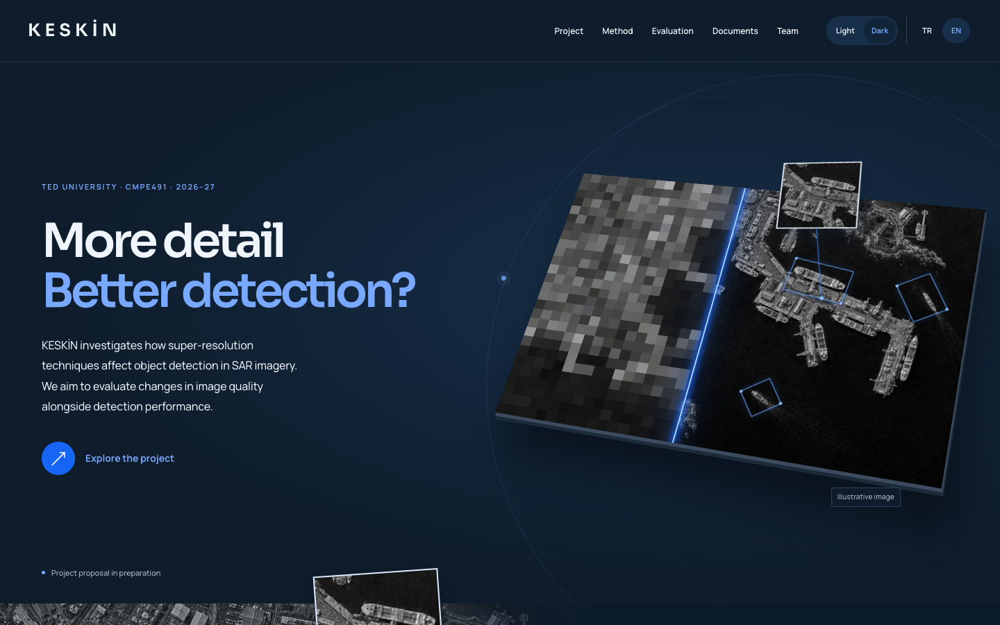

<div align="center">
  <a href="https://ilkeozcendek.github.io/keskin/">
    <picture>
      <source media="(prefers-reduced-motion: reduce) and (max-width: 640px)" srcset="./assets/readme/keskin-hero-mobile-still.svg" />
      <source media="(prefers-reduced-motion: reduce)" srcset="./assets/readme/keskin-hero-still.svg" />
      <source media="(max-width: 640px)" srcset="./assets/readme/keskin-hero-mobile.svg" />
      
    </picture>
  </a>
</div>

<p align="center">
  <strong>Improving Object Detection Performance in SAR Imagery<br />Using Super-Resolution Techniques</strong>
</p>

<p align="center">
  <a href="https://ilkeozcendek.github.io/keskin/"><strong>Explore the website</strong></a> &nbsp; · &nbsp;
  <a href="#the-research-question">Research</a> &nbsp; · &nbsp;
  <a href="#research-in-progress">Roadmap</a> &nbsp; · &nbsp;
  <a href="#the-keskin-team">Team</a>
</p>

## The research question

**Does a clearer image lead to better object detection?**

KESKİN investigates the relationship between **super-resolution** and **object detection** in synthetic aperture radar (SAR) imagery. We want to understand when additional image detail helps a detector find and locate objects, where it offers limited benefit, and what tradeoffs emerge.

Developed at **TED University** for **CMPE491 · 2026–27**, the project has completed and submitted its proposal and specifications. The current stage is feasibility and experiment design. This repository hosts the public website and project documents; research code and experimental results have not been published here yet.

## From imagery to evidence

<picture>
  <source media="(prefers-reduced-motion: reduce) and (max-width: 640px)" srcset="./assets/readme/research-flow-mobile-still.svg" />
  <source media="(prefers-reduced-motion: reduce)" srcset="./assets/readme/research-flow-still.svg" />
  <source media="(max-width: 640px)" srcset="./assets/readme/research-flow-mobile.svg" />
  
</picture>

1. **Prepare the data** — Assess HRSID and SSDD as candidate datasets and prepare image pairs using the selected data.
2. **Increase resolution** — Compare at least two deep learning super-resolution architectures, with EDSR and SRGAN being assessed as candidates.
3. **Detect objects** — Evaluate low-resolution and super-resolved inputs within the same detection evaluation setup.
4. **Measure the effect** — Examine image quality and detection performance separately, then report their relationship and limitations.

### Two perspectives, one research question

| Image quality | Object detection |
| :--- | :--- |
| How do detail and structure change? | Does that change help find and locate objects? |
| Compare outputs with reference imagery and selected quality measures. | Compare detection outcomes across the same evaluation setup. |

We are particularly interested in **small objects**, where useful detail is limited, and **busy scenes**, where nearby objects and complex backgrounds may make detection harder.

## Research in progress

| Stage | Focus | Status |
| :--- | :--- | :--- |
| **01 · Proposal & specifications** | Research scope, requirements, and evaluation protocol | **Completed and submitted** |
| **02 · Feasibility & experiment design** | Candidate dataset/model pilot and analysis report | **Current stage** |
| **03 · Implementation** | Super-resolution and detection comparisons | Planned |
| **04 · Analysis & sharing** | Findings, limitations, and project outputs | Planned |

The evaluation protocol is defined in the submitted specifications. HRSID/SSDD and EDSR/SRGAN remain dataset and super-resolution model candidates; the final selections and object detector are undecided. A feasibility pilot and the analysis report are next. No experimental results have been published.

### Project document archive

| Document | Version | Date | Availability |
| :--- | :--- | :--- | :--- |
| Project proposal | v1.0 | 16 October 2026 | [Open PDF](documents/keskin-project-proposal-v1.0.pdf) |
| Project specifications | v1.0 | 23 October 2026 | [Open PDF](documents/keskin-project-specifications-v1.0.pdf) |
| Project backlog | v1.0 | 23 October 2026 | [Open PDF](documents/keskin-backlog-v1.0.pdf) |
| Project backlog | v2.0 | Due 20 November 2026 | Planned |
| Project backlog | v3.0 | Due 31 December 2026 | Planned |

Published versions remain available at their own PDF links. Public copies omit identity numbers. Last updated: **23 October 2026**.

## The website

A visual introduction to the research, built with **HTML, CSS, JavaScript, and SVG** and published through **GitHub Pages**.

- **Explore the idea** with a draggable resolution comparison and separate image-quality and detection views.
- **Look closer** with animated small-detail and busy-scene exploration.
- **Follow the work** through the research roadmap, project archive, team, and questions.
- **Make it yours** with English/Turkish content, dark/light themes, and a responsive layout.

New visitors start in **English and dark mode**. The site remembers language and theme preferences, supports keyboard navigation, and respects reduced-motion settings.

<details>
<summary><strong>Take a look at the live website</strong></summary>
<br />
<a href="https://ilkeozcendek.github.io/keskin/">
  
</a>
</details>

<details>
<summary><strong>Run locally & navigate the source</strong></summary>

### Local preview

```bash
git clone https://github.com/IlkeOzcendek/keskin.git
cd keskin
```

Open `index.html` in your browser. No package installation or build step is required.

### Repository map

| File | Purpose |
| :--- | :--- |
| [`index.html`](index.html) | Page structure and research sections |
| [`content.js`](content.js) | English and Turkish content |
| [`styles.css`](styles.css) | Typography, themes, layout, and motion |
| [`app.js`](app.js) | Language, theme, menu, and interactive comparisons |
| [`documents/`](documents/) | Public project PDFs, preserved by version |
| [`assets/`](assets/) | Website imagery and favicon |
| [`assets/readme/`](assets/readme/) | Original animated SVGs and website preview |
| [`.nojekyll`](.nojekyll) | Static publishing configuration for GitHub Pages |

GitHub Pages publishes the root of `main`. Push website changes to that branch to update the live site; deployment progress appears in [Actions](https://github.com/IlkeOzcendek/keskin/actions).

The site uses Sora and Manrope from Google Fonts, with local fallback fonts. README illustrations are self-contained SVGs with no external font or animation service dependency.

</details>

<a name="the-keskin-team"></a>

## The KESKİN Team

| Busenur Arlı | İlke Özçendek | Zeynep Ersoy |
| :---: | :---: | :---: |
| Research team | Research team | Research team |

**Project adviser:** Prof. Dr. Gökçe Nur Yılmaz  
**TED University · CMPE491 · 2026–27**

<sub>The website’s radar-like harbor image is AI-generated. That image, the README illustrations, and the example detection boxes explain the research concept; they are not real SAR data, model outputs, or measured results.</sub>

<br /><br />

<a href="https://ilkeozcendek.github.io/keskin/">
  <picture>
    <source media="(prefers-reduced-motion: reduce)" srcset="./assets/readme/follow-the-research-still.svg" />
    
  </picture>
</a>
